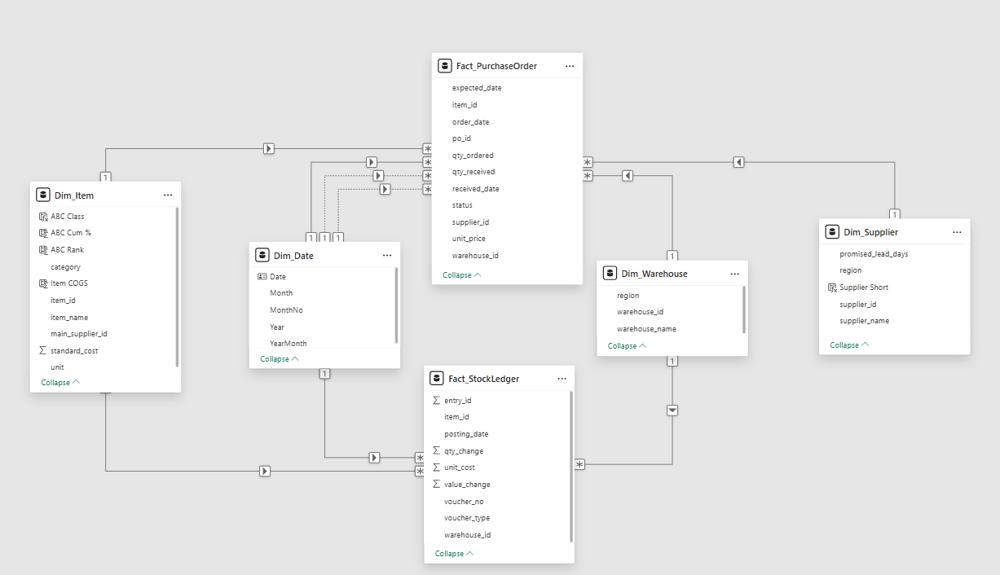
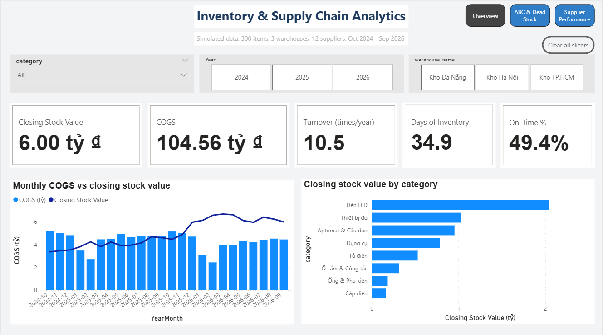
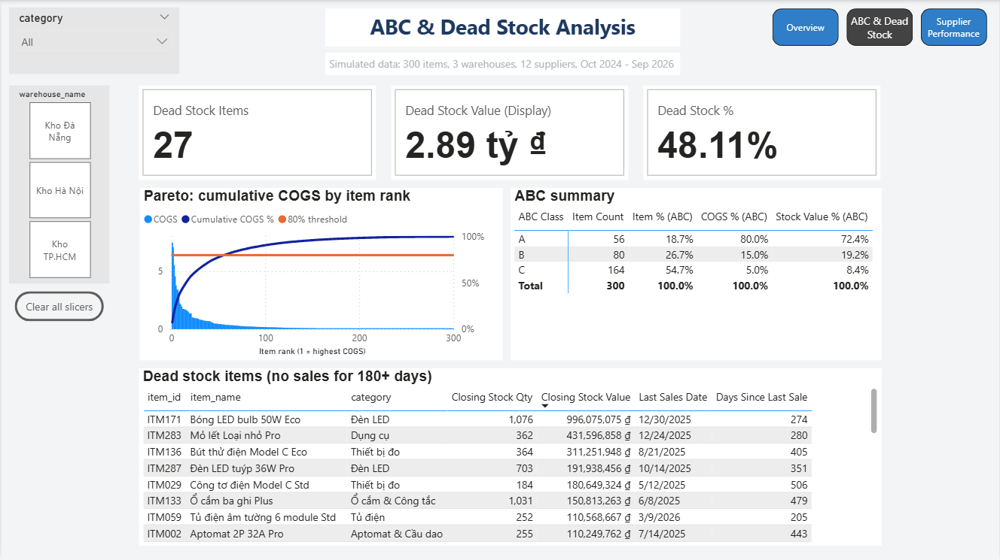
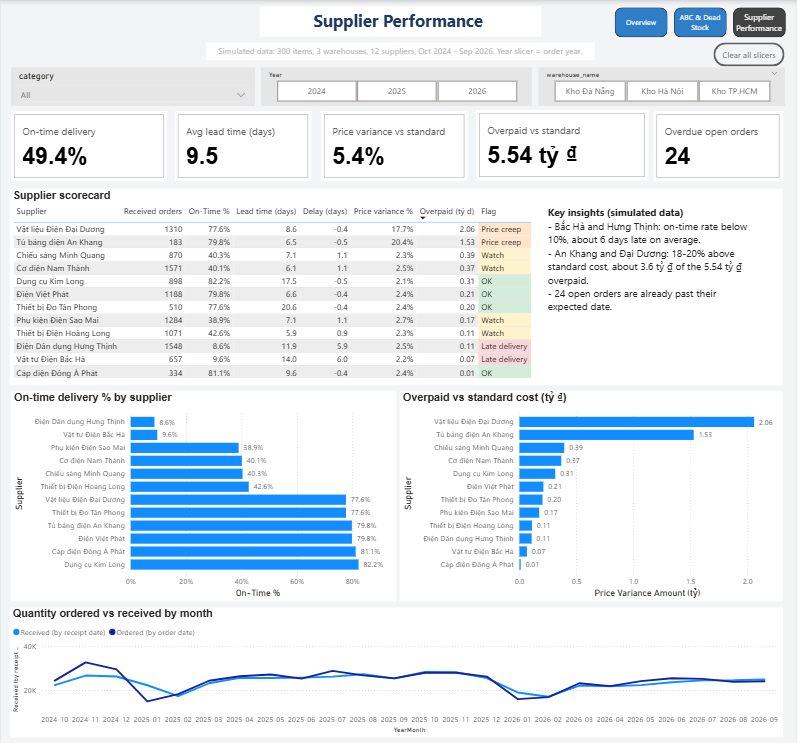
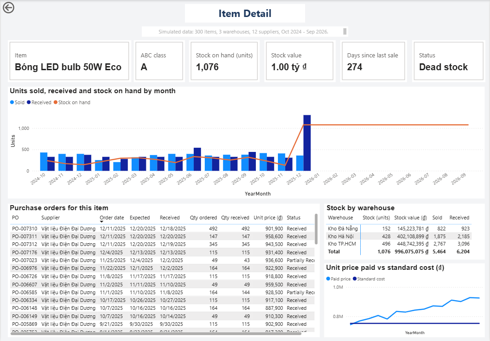

# Phân tích tồn kho và chuỗi cung ứng (Power BI)

Dashboard Power BI quản trị tồn kho và mua hàng cho một công ty phân phối vật tư thiết bị điện. Dashboard trả lời 3 câu hỏi:

1. Tiền đang nằm ở những mã hàng nào, hàng nào bán chậm hoặc không bán được (hàng tồn đọng)?
2. Mã hàng nào đóng góp phần lớn giá trị tiêu thụ (phân loại ABC) và cần kiểm soát chặt nhất?
3. Nhà cung cấp nào giao trễ, nhà cung cấp nào bán cao hơn giá chuẩn?

> **Lưu ý quan trọng: toàn bộ dữ liệu trong project này là dữ liệu MÔ PHỎNG** do script Python trong repo sinh ra, không phải dữ liệu của doanh nghiệp thật. Một số mẫu hình (nhà cung cấp trễ, tăng giá, hàng tồn đọng) được cài sẵn trong dữ liệu để kiểm chứng phương pháp phân tích. Các kết luận bên dưới có giá trị chứng minh kỹ năng, không phải kết luận về một doanh nghiệp cụ thể.


## Tóm tắt kết quả

| Chỉ số | Giá trị |
|---|---|
| Giá trị tồn kho cuối kỳ (30/09/2026) | 6,00 tỷ ₫ |
| Giá vốn hàng bán ra (24 tháng) | 104,56 tỷ ₫ |
| Vòng quay tồn kho (quy đổi theo năm) | 10,5 lần |
| Số ngày tồn kho trung bình | 34,9 ngày |
| Tỷ lệ đơn mua giao đúng hạn | 49,4% |
| Lead time trung bình | 9,5 ngày |
| Giá mua cao hơn giá chuẩn | +5,4% (khoảng 5,54 tỷ ₫) |
| Đơn mua quá hạn chưa nhận hàng | 24 đơn |

**Phát hiện chính (trên dữ liệu mô phỏng)**

- **Phân loại ABC:** 56 mã nhóm A (18,7% số mã) tạo ra 80,0% giá vốn. Nhóm C có 164 mã (54,7% số mã) nhưng chỉ chiếm 5,0% giá vốn và 8,4% giá trị tồn kho.
- **Hàng tồn đọng:** 27 mã không có lần bán nào trong 180 ngày cuối nhưng vẫn còn tồn, giữ khoảng **2,89 tỷ ₫, tương đương 48,1% giá trị kho**.
- **Nhà cung cấp giao trễ:** hai nhà cung cấp (Hưng Thịnh 8,6% và Bắc Hà 9,6%) chỉ giao đúng hạn dưới 10%, trễ trung bình khoảng 6 ngày.
- **Nhà cung cấp tăng giá:** An Khang và Đại Dương bán cao hơn giá chuẩn lần lượt 20,4% và 17,7%, hai nhà cung cấp này chiếm khoảng 3,59 tỷ ₫ trong tổng 5,54 tỷ ₫ chênh lệch giá (khoảng 65%).
- **Lead time dài chưa chắc là xấu:** hai nhà cung cấp nhập khẩu có lead time 17-21 ngày nhưng vẫn giao đúng hạn 78-82%.

**Ví dụ truy nguồn gốc hàng tồn đọng (trang Item Detail)**

Mã ITM171 (Bóng LED bulb 50W Eco) thuộc nhóm A, từng là mặt hàng bán chạy (giá vốn bán ra khoảng 4,56 tỷ ₫). Tồn kho quanh vài trăm đơn vị đến tháng 11/2025, rồi tăng vọt lên 1.076 vào tháng 12/2025 sau 3 đơn mua lớn trong cùng một ngày (11/12/2025) với giá cao hơn giá chuẩn khoảng 20-27%, và từ đó không bán thêm đơn vị nào. Kết quả là gần 1 tỷ ₫ tồn kho nằm yên.

**Đề xuất hành động**

1. Dừng đặt thêm và lên kế hoạch xả 27 mã tồn đọng, ưu tiên mã có giá trị lớn nhất (ITM171, ITM283, ITM136). Thêm kiểm soát: không cho đặt đơn mua lớn nếu mã chưa có doanh số trong thời gian gần đây.
2. Đàm phán lại giá với An Khang và Đại Dương, hoặc chuyển một phần đơn hàng sang nhà cung cấp khác trong cùng nhóm hàng.
3. Làm việc với Hưng Thịnh và Bắc Hà về cam kết giao hàng, hoặc tăng tồn kho an toàn cho các mã phụ thuộc vào hai nhà cung cấp này.
4. Xử lý 24 đơn mua đã quá hạn chưa nhận hàng.

## Kiểm chứng: dashboard có phát hiện đúng các mẫu hình cài sẵn không?

| Mẫu hình cài trong script | Dashboard phát hiện |
|---|---|
| Khoảng 10% mã ngừng bán sau một thời điểm, có đơn mua dư ngay trước đó | 27 mã tồn đọng, 2,89 tỷ ₫ |
| 2 nhà cung cấp hay giao trễ | Hưng Thịnh 8,6% và Bắc Hà 9,6% đúng hạn, nhãn "Late delivery" |
| 2 nhà cung cấp tăng giá dần | An Khang +20,4%, Đại Dương +17,7%, nhãn "Price creep" |
| Nhu cầu có tính mùa vụ (thấp dịp Tết) | Giá vốn các tháng 2 thấp hơn hẳn các tháng khác |

## Dữ liệu mô phỏng

Script `generate_inventory_data.py` mô phỏng từng ngày hoạt động của công ty từ 01/10/2024 đến 30/09/2026:

- Khách mua hàng (xuất kho) theo nhu cầu ngẫu nhiên có mùa vụ, mỗi mã một mức nhu cầu khác nhau.
- Khi tồn kho chạm điểm đặt lại thì phát sinh đơn mua, nhà cung cấp giao sau số ngày hứa cộng độ lệch ngẫu nhiên.
- Giá mua dao động quanh giá chuẩn, một số nhà cung cấp tăng giá dần theo tháng.
- Giá vốn xuất kho tính theo bình quân gia quyền di động.

| File | Vai trò | Số dòng |
|---|---|---|
| `fact_stock_ledger.csv` | Fact: mỗi dòng là một lần nhập, xuất hoặc điều chỉnh kho | 202.363 |
| `fact_purchase_order.csv` | Fact: mỗi dòng là một đơn mua của một mã hàng | 11.584 |
| `dim_item.csv` | Dim: 300 mã hàng, 8 nhóm hàng, giá chuẩn | 300 |
| `dim_supplier.csv` | Dim: 12 nhà cung cấp, số ngày hứa giao | 12 |
| `dim_warehouse.csv` | Dim: 3 kho (Hà Nội, Đà Nẵng, TP.HCM) | 3 |

Chạy lại: `python generate_inventory_data.py` (cần `pandas` và `numpy`), kết quả nằm trong thư mục `data/`. Script dùng số ngẫu nhiên cố định nên kết quả luôn giống nhau.

## Mô hình dữ liệu (Star Schema, 2 bảng Fact)



| Từ (phía 1) | Sang (phía nhiều) | Trạng thái |
|---|---|---|
| `Dim_Item[item_id]` | `Fact_StockLedger[item_id]`, `Fact_PurchaseOrder[item_id]` | Active |
| `Dim_Warehouse[warehouse_id]` | `Fact_StockLedger[warehouse_id]`, `Fact_PurchaseOrder[warehouse_id]` | Active |
| `Dim_Supplier[supplier_id]` | `Fact_PurchaseOrder[supplier_id]` | Active |
| `Dim_Date[Date]` | `Fact_StockLedger[posting_date]` | Active |
| `Dim_Date[Date]` | `Fact_PurchaseOrder[order_date]` | Active |
| `Dim_Date[Date]` | `Fact_PurchaseOrder[expected_date]`, `Fact_PurchaseOrder[received_date]` | Inactive, dùng với `USERELATIONSHIP` |

Đơn mua có 3 mốc ngày nhưng bảng lịch chỉ nối active với ngày đặt hàng, hai mốc còn lại dùng `USERELATIONSHIP`. Hai bảng Fact không nối trực tiếp với nhau, chỉ gặp nhau qua các bảng Dim dùng chung.

## Phương pháp

- **Tồn kho cuối kỳ** là số dư cộng dồn: cộng mọi giao dịch từ đầu đến hết kỳ đang xét (bỏ bộ lọc ngày hiện tại rồi lọc lại bằng `<= ngày cuối kỳ`). Vì vậy một tháng trên biểu đồ ra tồn cuối tháng, không phải nhập xuất của riêng tháng đó.
- **Vòng quay tồn kho** = giá vốn / tồn kho trung bình (trung bình các số dư cuối tháng), quy đổi theo năm. **Số ngày tồn kho** = tồn kho trung bình / giá vốn bình quân mỗi ngày.
- **Phân loại ABC:** xếp mã theo giá vốn bán ra giảm dần, nhóm A là các mã có phần trăm cộng dồn trước nó dưới 80%, nhóm B dưới 95%, còn lại là nhóm C. Tính bằng cột tính sẵn, nên cố định theo cả giai đoạn.
- **Hàng tồn đọng:** mã còn tồn kho và không có lần bán nào trong 180 ngày trước ngày cuối của dữ liệu.
- **Hiệu suất nhà cung cấp:** giao đúng hạn là ngày nhận thực tế nhỏ hơn hoặc bằng ngày hẹn giao (chỉ tính đơn đã nhận). Chênh lệch giá là (số lượng đặt x giá thực tế) trừ (số lượng đặt x giá chuẩn). Nhãn cảnh báo: dưới 20% đúng hạn là "Late delivery", chênh lệch giá trên 10% là "Price creep", dưới 50% đúng hạn là "Watch".
- **`USERELATIONSHIP`:** so sánh số lượng đặt theo tháng đặt hàng với số lượng nhận theo tháng hàng thực sự về kho.

Toàn bộ công thức nằm trong [`dax/measures.md`](dax/measures.md).

## Các trang dashboard

| Trang | Nội dung |
|---|---|
| Overview | 5 KPI (giá trị tồn kho, giá vốn, vòng quay, số ngày tồn kho, đúng hạn), giá vốn so với tồn kho theo tháng, tồn kho theo nhóm hàng, slicer năm, kho, nhóm hàng |
| ABC & Dead Stock | Biểu đồ Pareto, bảng tóm tắt ABC, 3 KPI hàng tồn đọng, danh sách 27 mã tồn đọng |
| Supplier Performance | 5 KPI nhà cung cấp, bảng chấm điểm có nhãn cảnh báo màu, đúng hạn và chênh lệch giá theo nhà cung cấp, số lượng đặt so với nhận theo tháng |
| Item Detail | Trang drill-through (chuột phải vào một mã hàng): thông tin mã, nhập xuất tồn theo tháng, tồn theo kho, giá mua so với giá chuẩn, lịch sử đơn mua |






## Hạn chế

- **Dữ liệu là mô phỏng.** Các tỷ lệ như 48,1% giá trị kho là hàng tồn đọng phụ thuộc vào tham số của script (đơn mua dư trước khi mã ngừng bán), không phản ánh một doanh nghiệp thật.
- Dữ liệu không mô phỏng trả hàng, khuyến mãi, tồn kho hết hàng gây mất doanh số.
- Nhóm ABC và cờ hàng tồn đọng tính theo cả giai đoạn, nên slicer năm không tính lại hai thứ này. Hàng tồn đọng tính tại ngày cuối dữ liệu.
- Trên trang Supplier Performance, slicer Year lọc theo **năm đặt hàng**.
- 160 đơn mua đặt vào những ngày cuối dữ liệu chưa kịp nhận hàng (trạng thái Open), nên chưa được đưa vào các chỉ số giao hàng.

## Cấu trúc repo

```
.
├── README.md
├── Inventory_Dashboard.pbix
├── generate_inventory_data.py
├── dax/
│   └── measures.md
├── data/                      # 5 file CSV (có thể sinh lại bằng script)
└── images/
    ├── demo.gif
    ├── data_model.png
    ├── page1_overview.png
    ├── page2_abc_dead_stock.png
    ├── page3_supplier_performance.png
    └── page4_item_detail.png
```

## Cách mở file

Mở `Inventory_Dashboard.pbix` bằng **Power BI Desktop** (miễn phí). Dữ liệu đã được nhúng sẵn trong file. Nếu muốn làm mới, chạy script để có thư mục `data/`, rồi vào **Transform data** → **Data source settings** để trỏ lại đường dẫn các file CSV.

## Kỹ năng thể hiện

Mô phỏng dữ liệu bằng Python (pandas, numpy), Power Query, Star Schema với hai bảng Fact, quan hệ nhiều mốc ngày (`USERELATIONSHIP`), DAX (tồn kho cộng dồn, `CALCULATE`, `FILTER`, `SUMX`, `RANKX`, `SWITCH`, `VAR`), phân loại ABC, phân tích hàng tồn đọng, đánh giá nhà cung cấp, drill-through, thiết kế dashboard, rút insight và đề xuất hành động.
